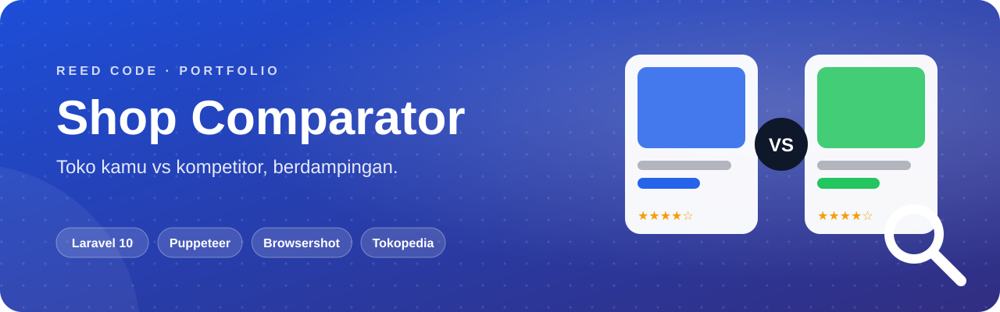
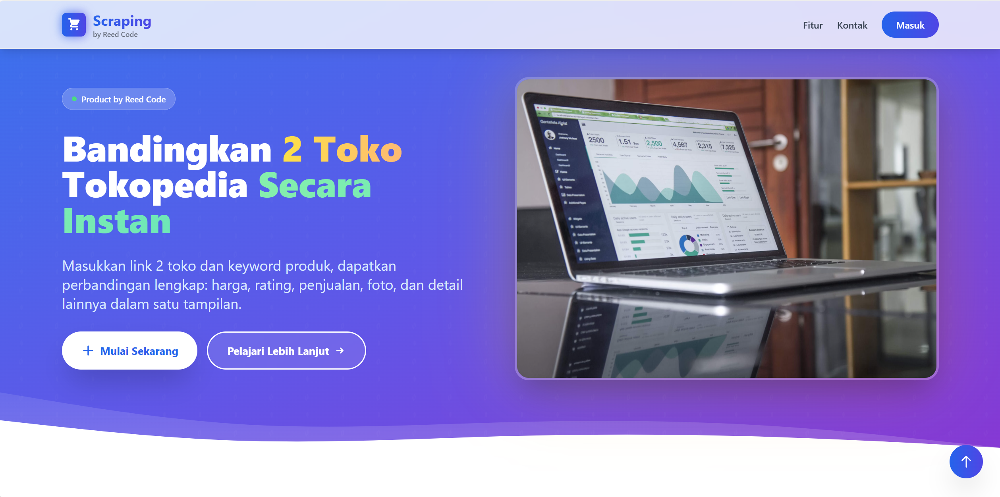
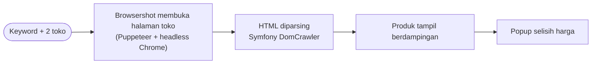

<p align="center">
  
</p>

<p align="center">
  <b>Tahu posisi harga tokomu dalam hitungan detik.</b> Masukkan satu keyword, lalu bandingkan produk tokomu dengan kompetitor di Tokopedia secara berdampingan.
</p>

<p align="center">
  <a href="#sekilas">Sekilas</a> ·
  <a href="#kemampuan">Kemampuan</a> ·
  <a href="#alur-kerja">Alur Kerja</a> ·
  <a href="#mulai-menjalankan">Mulai Menjalankan</a> ·
  <a href="#akun-demo">Akun Demo</a> ·
  <a href="#catatan">Catatan</a>
</p>

<p align="center">
  
  <br>
  
  
  
</p>

## Sekilas

Alat riset harga untuk penjual online. Pilih **toko yang kamu kelola** dan **toko saingan**, masukkan keyword, lalu sistem membuka kedua toko di Tokopedia dan menampilkan produknya berdampingan: foto, harga, rating, dan jumlah terjual. Klik satu produk dari tiap sisi untuk langsung melihat selisih harganya.

<p align="center">
  
</p>

## Kemampuan

<table>
  <tr>
    <td width="50%" valign="top"><b>🏬 Daftar Toko</b><br>Simpan link toko Tokopedia dengan label <i>dikelola</i> atau <i>saingan</i>.</td>
    <td width="50%" valign="top"><b>🔎 Pencarian Serentak</b><br>Satu keyword dicari di kedua toko sekaligus.</td>
  </tr>
  <tr>
    <td valign="top"><b>🧩 Panel Berdampingan</b><br>Dua daftar produk, masing-masing dengan pagination sendiri.</td>
    <td valign="top"><b>📊 Popup Selisih Harga</b><br>Bandingkan dua produk terpilih dalam rupiah dan persen.</td>
  </tr>
  <tr>
    <td valign="top"><b>📈 Dashboard</b><br>Jumlah toko yang dikelola dan pengguna yang sedang online.</td>
    <td valign="top"><b>👥 Tim</b><br>Role <code>admin</code> dan <code>karyawan</code>, dengan manajemen pengguna khusus admin.</td>
  </tr>
</table>

## Alur Kerja



Produk Tokopedia dirender dengan JavaScript, sehingga halaman dibuka memakai browser headless, bukan request HTTP biasa.

## Mulai Menjalankan

> Butuh **PHP 8.1+**, **Composer**, **Node.js 18+**, dan **MySQL**. Puppeteer mengunduh Chromium otomatis saat `npm install`.

```bash
git clone https://github.com/KyyStacy/tokopedia-shop-comparator.git
cd tokopedia-shop-comparator

composer install && npm install
cp .env.example .env && php artisan key:generate
# isi DB_DATABASE, DB_USERNAME, DB_PASSWORD di .env

php artisan migrate --seed

npm run dev            # terminal 1
php artisan serve      # terminal 2  →  http://localhost:8000
```

## Akun Demo

| Role | Email | Password |
|---|---|---|
| Admin | `admin@reedcode.id` | `admin123` |
| Karyawan | `karyawan1@reedcode.id` · `karyawan2@reedcode.id` · `karyawan3@reedcode.id` | `karyawan` |

## Catatan

- Struktur halaman Tokopedia bisa berubah sewaktu-waktu. Jika hasil scraping kosong, sesuaikan parser di `app/Http/Controllers/ComparisonController.php`.
- Dibuat untuk belajar dan riset harga. Gunakan secara wajar dan patuhi ketentuan layanan Tokopedia.

---

<div align="center">

<h2>Dibuat oleh Kyy Stacy × Reed Code</h2>

<p><i>Web & app developer: dari landing page sampai sistem bisnis custom.</i></p>

<a href="https://www.instagram.com/reedcode.id"></a>
<a href="https://www.tiktok.com/@reedcode.id"></a>
<a href="https://github.com/KyyStacy"></a>

<br><br>

<table>
  <tr>
    <td colspan="4" align="center"><b>Punya ide aplikasi atau butuh website untuk bisnismu?</b><br><sub>Reed Code siap bantu dari desain sampai online.</sub></td>
  </tr>
  <tr>
    <td align="center" width="25%">🌐<br><b>Company Profile</b><br><sub>Website brand & usaha</sub></td>
    <td align="center" width="25%">🛒<br><b>Toko Online</b><br><sub>Katalog & pembayaran online</sub></td>
    <td align="center" width="25%">📊<br><b>Sistem Bisnis</b><br><sub>Kasir, inventaris, booking</sub></td>
    <td align="center" width="25%">📱<br><b>Aplikasi Mobile</b><br><sub>Android & iOS</sub></td>
  </tr>
</table>

<a href="https://wa.me/6285171713355?text=Halo%20Reed%20Code%2C%20saya%20tertarik%20dengan%20jasa%20pembuatan%20website"></a>

<br><br>

<sub>© 2026 Kyy Stacy · Reed Code</sub>

</div>
